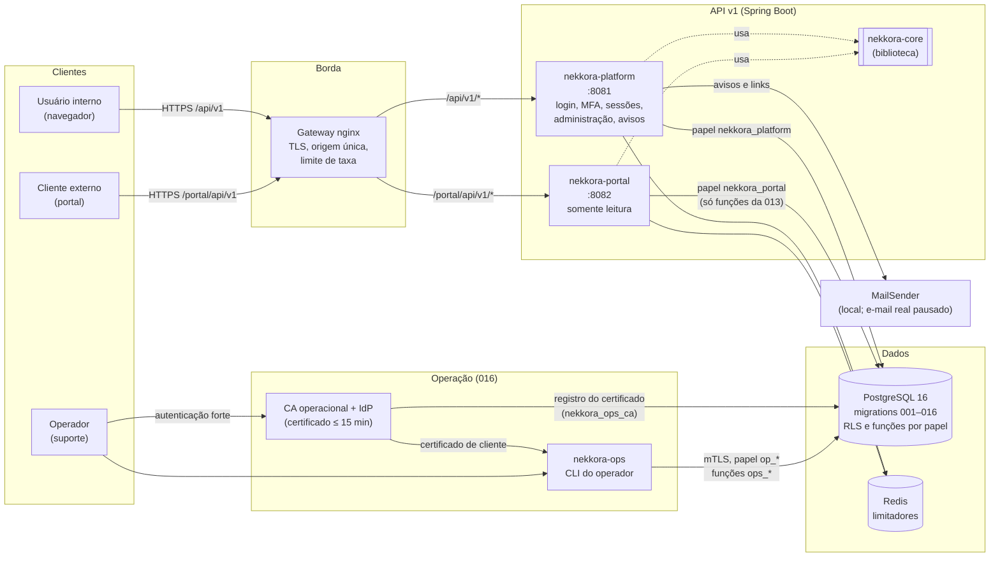

# Nekkora Platform

Backend da plataforma Nekkora: API v1 (Platform e portal externo), banco PostgreSQL com migrations versionadas e ferramentas de operação.

> **Estado:** não está pronto para produção. Os gates de produção estão nos relatórios em `docs/relatorios/`. A migration `016` (recuperação emergencial de MFA) é **candidata** e não deve ser aplicada em bases persistentes sem autorização.

## Estrutura do repositório

| Pasta | Conteúdo |
|---|---|
| `api/` | Código Java (Maven multi-módulo, Java 21, Spring Boot): os quatro módulos abaixo, o E2E local (`api/e2e`) e o benchmark de Argon2 |
| `db/migrations/` | Migrations SQL `001`–`016` (schema, papéis, RLS e funções). É a fonte de verdade do banco |
| `db/tests/` | Suítes de banco por migration (containers descartáveis) |
| `ops/` | Operação: homologação interna (`ops/homologacao`) e validação da recuperação emergencial de MFA (`ops/mfa-emergencia`) |
| `docs/relatorios/` | Contratos, decisões, relatórios de validação e planos |
| `docker-compose.yml` | Stack principal de banco local (`nekkora-postgres`). Leia o aviso em [Banco da stack principal](#banco-da-stack-principal-docker-composeyml) |

## Módulos da API

| Módulo | O que é | Executa como | Papel no banco |
|---|---|---|---|
| **`nekkora-core`** | Biblioteca compartilhada pela Platform e pelo Portal: transação com contexto da organização (`set_config`), reset de conexão, erros HTTP padronizados, IP do proxy confiável, limitador no Redis, tokens e máscara de log | — (biblioteca) | — |
| **`nekkora-platform`** | Serviço principal, voltado aos usuários internos: login, MFA TOTP, sessões, CSRF, senha, administração (incl. reset de MFA) e o lado da Platform na recuperação emergencial de MFA (avisos, confirmação e contestação por link) | Processo HTTP, porta **8081** | `nekkora_platform` |
| **`nekkora-portal`** | Portal externo, **somente leitura** (`GET`) para clientes, sobre as funções da migration 013. Processo, credencial e papel próprios: não recebe nenhuma configuração da Platform | Processo HTTP, porta **8082** | `nekkora_portal` |
| **`nekkora-ops`** | Ferramentas de **operação** da recuperação emergencial de MFA (016): CLI dos operadores (`OpsCli`), autenticada no banco por certificado de cliente de curta duração, e as bibliotecas da CA operacional e do verificador do IdP. Não depende dos outros módulos; conversa com o banco pelas funções `ops_*` | CLI (linha de comando) | `op_<pessoa>` (certificado), `nekkora_ops_ca` |

## Arquitetura



**Como as peças se encontram:**
- **Usuários:**
  - o gateway é a única porta de entrada e decide pelo caminho: `/api/v1/…` vai para a Platform e `/portal/api/v1/…` para o Portal;
  - os dois processos ficam isolados um do outro e cada um usa o próprio papel no banco;
  - o banco aplica RLS e só expõe o que cada papel pode fazer.
- **Recuperação emergencial de MFA (016):**
  - o operador age pela CLI, com certificado de curta duração;
  - a CLI chama as funções `ops_*`, que conferem autoria e autorização **no banco**;
  - a Platform emite os avisos e recebe a confirmação ou a contestação do titular pelas funções `ops_notice_*`.
  - Platform e `nekkora-ops` **não** dependem um do outro em Java: o ponto de encontro é o banco.
- **Redis:** só para limitadores de taxa e estado efêmero. Nenhum dado de negócio.

## Executar em desenvolvimento

**Requisitos:** Java 21, Docker e Git Bash (Windows), Linux ou macOS. O Maven vem pelo wrapper (`api/mvnw`).

### Opção 1 — ambiente inteiro com um comando (recomendado)

Sobe PostgreSQL 16 (migrations `001`–`015`, instalação limpa), Redis, Platform, Portal e nginx com TLS, numa stack Compose **isolada e descartável**:
- segredos aleatórios por execução;
- rede e portas próprias;
- nunca toca a stack principal.

```sh
api/e2e/run.sh
```

- **Acesso:**
  - API: `https://localhost:55443/api/v1/…`;
  - portal: `https://localhost:55443/portal/api/v1/…`;
  - PostgreSQL em `127.0.0.1:55444`.
- **Certificado:** TLS descartável, de 1 dia, para `localhost`.
- **Portas diferentes:** `E2E_PROJETO=nekkora-e2e-b E2E_PORTA=55453 E2E_PG_PORTA=55454 api/e2e/run.sh`.
- **Ao final:** a stack fica no ar, e o script imprime o comando de remoção dela.

### Opção 2 — processos no host (depuração na IDE)

Banco e Redis em containers descartáveis; Platform e Portal rodando localmente, por exemplo pela IDE, com as variáveis abaixo.

```sh
# 1. build dos jars (a partir de api/)
cd api && ./mvnw -q -DskipTests package && cd ..

# 2. PostgreSQL 16 descartável com as migrations 001-015 (a 016 é candidata e fica de fora)
MIG="$(mktemp -d)"; for n in $(seq -w 1 15); do cp db/migrations/0${n}_*.sql "$MIG/"; done
MSYS_NO_PATHCONV=1 docker run -d --name nekkora-dev-postgres \
  -e POSTGRES_DB=nekkora -e POSTGRES_USER=nekkora -e POSTGRES_PASSWORD=dev-super \
  -p 127.0.0.1:55432:5432 -v "$(cygpath -m "$MIG" 2>/dev/null || echo "$MIG"):/docker-entrypoint-initdb.d:ro" \
  postgres:16-alpine
docker run -d --name nekkora-dev-redis -p 127.0.0.1:56379:6379 redis:7-alpine redis-server --save "" --appendonly no

# 3. quando o log mostrar "database system is ready to accept connections" pela 2ª vez: senhas dos papéis de serviço
docker exec -i nekkora-dev-postgres psql -X -q -U nekkora -d nekkora \
  -c "ALTER ROLE nekkora_platform PASSWORD 'dev-platform'" -c "ALTER ROLE nekkora_portal PASSWORD 'dev-portal'"

# 4. Platform (porta 8081)
NEKKORA_DB_URL=jdbc:postgresql://localhost:55432/nekkora NEKKORA_DB_SENHA=dev-platform \
NEKKORA_REDIS_HOST=localhost NEKKORA_REDIS_PORT=56379 NEKKORA_ORIGEM_PUBLICA=http://localhost:8081 \
NEKKORA_MFA_CHAVE_ID=k1 NEKKORA_MFA_CHAVES="k1:$(head -c 32 /dev/urandom | base64)" \
NEKKORA_HMAC_ID=h1 NEKKORA_HMAC_CHAVE="$(head -c 32 /dev/urandom | base64)" \
java -jar api/nekkora-platform/target/nekkora-platform-0.1.0-SNAPSHOT.jar

# 5. Portal (porta 8082), em outro terminal
NEKKORA_PORTAL_DB_URL=jdbc:postgresql://localhost:55432/nekkora NEKKORA_PORTAL_DB_SENHA=dev-portal \
NEKKORA_REDIS_HOST=localhost NEKKORA_REDIS_PORT=56379 \
java -jar api/nekkora-portal/target/nekkora-portal-0.1.0-SNAPSHOT.jar
```

**Conferência rápida:**
- `curl http://localhost:8081/api/v1/csrf` → `200`;
- `curl http://localhost:8082/portal/api/v1/o/00000000-0000-4000-8000-000000000000/workspaces` → `401`, porque não há sessão.

**Limpeza:** pare os dois processos e remova só os containers desta receita, com `docker rm -f nekkora-dev-postgres nekkora-dev-redis`. Depois apague a pasta temporária impressa em `echo "$MIG"`.

**Observações:**
- As senhas e chaves acima são **só de desenvolvimento local**. Em qualquer outro ambiente, os segredos vêm do ambiente ou de um cofre, nunca do repositório.
- Os cookies de sessão são `__Host-` e `Secure`. Para exercitar pelo navegador com TLS e origem única, use a Opção 1.
- Nesta receita a Platform e o Portal ficam sem o gateway. A origem única, o TLS e o limite de taxa do nginx só existem na Opção 1.
- As rotas da recuperação emergencial dependem da 016, que não está nessas instalações; ela é exercitada pelos testes.
- As variáveis de ambiente de cada processo estão em [`api/README.md`](api/README.md#configuração-só-por-ambiente-nada-versionado).

### Banco da stack principal (`docker-compose.yml`)

O `docker-compose.yml` da raiz sobe o `nekkora-postgres` na porta `5432`, com volume **persistente** (`nekkora_postgres_data`).

> **Atenção:** na primeira inicialização de um volume vazio, ele aplica **todas** as migrations de `db/migrations/`, inclusive a `016` candidata, e não configura Redis nem as senhas dos papéis de serviço. Para desenvolvimento, prefira as opções 1 ou 2, que são descartáveis e usam `001`–`015`.

## Testes

```sh
cd api && ./mvnw test                  # unitários e integração (Testcontainers: PostgreSQL e Redis descartáveis)
db/tests/mfa-emergencia-016/run.sh     # suíte de banco da 016 (instalação limpa e atualização de base populada)
ops/mfa-emergencia/validar.sh          # validação completa da 016: suíte de banco, Maven, mutações, varredura e preservação
```

- **Outras suítes de banco:** `db/tests/*/run.sh`, listadas em [`api/README.md`](api/README.md#comandos).
- Nenhum teste usa a stack principal: todos sobem recursos próprios e descartáveis.

**CLI de operação (`nekkora-ops`):**
- é exercitada pelos testes (`OpsCliContinuidadeIT`, `FluxoOperacionalIT`), com CA e IdP simulados;
- fora deles, depende de CA operacional, IdP e `pg_hba` com certificado. Isso ainda não existe em nenhum ambiente e está descrito no plano de homologação da 016 (`docs/relatorios/2026-09-28-mfa-emergencia-plano-homologacao-016.md`).

## Documentação

| Tema | Onde |
|---|---|
| API v1: módulos, comandos e configuração | [`api/README.md`](api/README.md) |
| Homologação interna | [`ops/homologacao/README.md`](ops/homologacao/README.md) |
| Recuperação emergencial de MFA (016) | `docs/relatorios/2026-09-27-contrato-recuperacao-emergencial-mfa.md`, `…-mfa-emergencia-implementacao.md`, `…-matriz-016.md` |
| Decisões, contratos e validações | `docs/relatorios/` |
