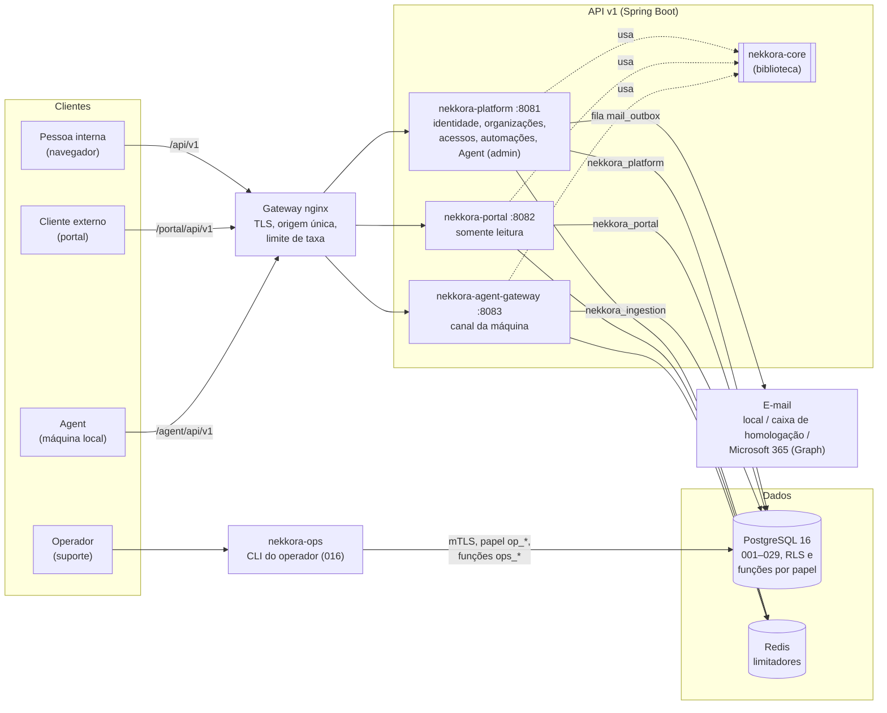

# Nekkora Platform API — V1

Backend da plataforma Nekkora: API das pessoas (Platform), portal externo somente leitura (Portal), canal da máquina (Agent Gateway), banco PostgreSQL com migrations versionadas e ferramentas de operação.

Este é o **documento único** do projeto. Ele substitui os relatórios por missão (`docs/relatorios/`), os READMEs de cada pasta e as suítes por migration. O histórico de decisões, contratos e validações continua no Git: tudo que existia até o commit `ad2764b` pode ser lido com `git show ad2764b:<caminho>`.

> **Estado:** V1 funcional. Todas as migrations `001`–`029` fazem parte da instalação e são aplicadas pelo modelo do migrador (ver [Banco](#banco)). Liberar para produção continua sendo uma decisão da responsável, fora deste repositório.

## Sumário

- [Estrutura do repositório](#estrutura-do-repositório)
- [Arquitetura](#arquitetura)
- [Módulos](#módulos)
- [Fluxo funcional](#fluxo-funcional)
- [Banco](#banco)
- [Configuração](#configuração)
- [E-mail](#e-mail)
- [Executar em desenvolvimento](#executar-em-desenvolvimento)
- [Testes](#testes)
- [Homologação](#homologação)
- [Convenções](#convenções)

## Estrutura do repositório

| Pasta | Conteúdo |
|---|---|
| `api/` | Java 21, Spring Boot, Maven multi-módulo (`./mvnw`). Módulos `nekkora-core`, `nekkora-platform`, `nekkora-portal`, `nekkora-agent-gateway` e `nekkora-ops`; contratos OpenAPI em `api/openapi/`; E2E entre processos em `api/e2e/` |
| `db/migrations/` | Migrations SQL `001`–`029`, fonte de verdade do banco (schema, papéis, RLS e funções). **Nunca editar uma migration aplicada**: o sha256 é conferido pela implantação |
| `db/bootstrap/` | `aplicar_como_migrador.sh` (modelo do migrador) e o bootstrap da organização interna |
| `db/tests/` | Suíte de banco da V1 (`run.sh`): instalação limpa de todas as migrations |
| `ops/homologacao/` | Ambiente de homologação isolado e reproduzível (`homologacao.sh`), implantação com elevação controlada, e-mail real e canal do Agent |
| `docker-compose.modelo.yml` | Banco de desenvolvimento no modelo do migrador (volume próprio, porta `5433`) |
| `docker-compose.yml` | Stack principal antiga (`nekkora-postgres`, porta `5432`, volume persistente). Ver o aviso em [Banco](#banco) |

## Arquitetura



- O gateway é a única porta de entrada e decide pelo caminho.
- Cada processo tem papel próprio no banco e não recebe configuração nem credencial dos outros. O banco aplica RLS e só expõe a cada papel as funções que ele pode chamar.
- Platform, Portal, Agent Gateway e `nekkora-ops` não dependem uns dos outros em Java: o ponto de encontro é o banco.
- O Redis guarda só limitadores e estado efêmero, nenhum dado de negócio.

## Módulos

| Módulo | O que é | Executa como | Papel no banco |
|---|---|---|---|
| `nekkora-core` | Biblioteca compartilhada: transação com contexto da organização (`set_config` por bind), reset de conexão (`DISCARD ALL`), erros HTTP padronizados, IP do proxy confiável, limitador no Redis, tokens e máscara de log | biblioteca | — |
| `nekkora-platform` | Serviço das pessoas: cadastro, login, MFA, sessões, CSRF, organizações, acessos, automações, administração do Agent, e-mail e avisos da recuperação emergencial de MFA | HTTP, porta **8081** | `nekkora_platform` |
| `nekkora-portal` | Portal externo, **somente `GET`**, sobre as funções da 013 (workspaces e execuções do cliente) | HTTP, porta **8082** | `nekkora_portal` |
| `nekkora-agent-gateway` | Canal da máquina do contrato Platform–Agent 1.0: resgate do pareamento, heartbeat, autorizações de execução local, registro da execução, relatório do supervisor e ingestão de eventos com ACK depois do commit. Credencial de máquina (`Bearer nka1…`), sem cookie, sessão ou CSRF | HTTP, porta **8083** | `nekkora_ingestion` |
| `nekkora-ops` | CLI dos operadores da recuperação emergencial de MFA (016), autenticada no banco por certificado de cliente de curta duração; bibliotecas da CA operacional e do verificador do IdP | linha de comando | `op_<pessoa>`, `nekkora_ops_ca` |

Os contratos HTTP estão em `api/openapi/nekkora-api-v1.yaml` (Platform e Portal) e `api/openapi/nekkora-agent-v1.yaml` (Agent Gateway).

## Fluxo funcional

### Identidade e entrada

- **Cadastro** (`/api/v1/signup`, confirmação por e-mail) e **entrada geral** (`/api/v1/auth/login`) da identidade global. Rotas desligadas por padrão (`NEKKORA_CADASTRO`, `NEKKORA_ENTRADA_GERAL`): desligadas, respondem `404`.
- **Senha:** Argon2id (`NEKKORA_ARGON2_M`/`T`). Troca (`/auth/password`) e **recuperação por e-mail** (`/auth/password-reset/*`, chave `NEKKORA_RECUPERACAO_SENHA`, prazo do token de 30 min).
- **MFA (TOTP) opcional (029):**
  - quem **nunca confirmou** um fator entra só com a senha; nas ações sensíveis, a senha digitada de novo há até 5 min na mesma sessão substitui o código;
  - quem tem ou já teve fator continua com TOTP no login e nas ações, e a senha nunca substitui o código (o banco recusa);
  - a ativação voluntária (`/auth/mfa/activate/*`) é definitiva e revoga as outras sessões; códigos de recuperação em `/auth/mfa/recovery-codes`.
- **Step-up** (`/auth/step-up`, `/auth/password-confirm`): exigido para criar organização, aceitar convite, vincular conta, trocar senha, emitir convites, atribuir papéis, aprovar concessões, parear e gerir o Agent, autorizar execução local, publicar versão e resetar MFA.
- **Sessões:** cookies `__Host-`, `Secure`; prazo absoluto 12 h; inatividade 30 min (interna) e 15 min (externa); até 10 sessões por conta.

### Organizações

- **Criação** (`POST /api/v1/organizations`), **listagem** (`/me/organizations`) e **troca** para a sessão da organização (`/sessions/organization`). Limite de 10 organizações por identidade, conferido no banco.
- **Vinculação de conta antiga** (`/links/*`, chave `NEKKORA_VINCULACAO`).
- Rotas da organização em `/api/v1/o/{org}/…`, com a sessão da organização e CSRF.

### Acessos

- **Convites** (emitir, reenviar, revogar, aceitar; chave `NEKKORA_CONVITES`).
- **Papéis** (atribuir, substituir, revogar), **retirada de vínculo**, **suspensão/reativação** de usuário e **reset de MFA**.
- **Concessões de cliente** (criar, aprovar, renovar, revisar, revogar).
- **Leitura:** permissões (`/me/permissions`), membros, clientes e eventos de acesso.

### Automações e Agent

- **Ciclo de vida (028):** workspace → automação → versão (nasce `DRAFT`) → envio do **artefato** (ZIP gerado pelo Studio; a API confere o pacote e a impressão `package-fingerprint/1`) → **publicação** (pessoa com step-up; `PUBLISHED` é imutável). Armazenamento local dos artefatos em `NEKKORA_ARTEFATOS_DIR`.
- **Agent:** pareamento (`agent-enrollments`), credencial com rotação e revogação, Workers autorizados por workspace e **autorizações de execução local** (até 366 dias).
- **Canal da máquina** (`/agent/api/v1/*`): o Agent resgata o pareamento, manda heartbeat, baixa autorizações, registra execuções e envia fatos. O desfecho de uma execução só muda por relatório do supervisor autenticado. A Platform **não** executa, despacha nem entrega pacote ao Agent.
- **Leitura:** workspaces, automações, versões, execuções e eventos (`/api/v1/o/{org}/…`); execuções do Agent em `agent-runs`.

### Portal externo

Somente leitura para clientes (`/portal/api/v1/o/{org}/workspaces`, `executions`, `executions/{id}`, `executions/{id}/events`), sobre as concessões aprovadas.

### Recuperação emergencial de MFA (016)

O operador age pela CLI `nekkora-ops`, com certificado de curta duração, e as funções `ops_*` conferem autoria e autorização no banco. A Platform emite os avisos (chave `NEKKORA_AVISOS_EMERGENCIA`) e recebe a confirmação ou a contestação do titular (`/auth/mfa-emergencia/aviso/*`).

## Banco

- **PostgreSQL 16**, migrations `001`–`029` em `db/migrations/`. As migrations são a fonte de verdade: schema, papéis, RLS, funções `SECURITY DEFINER` e invariantes conferidos no fim de cada uma.
- **Modelo do migrador** (`db/bootstrap/aplicar_como_migrador.sh`): aplica as migrations como `migrador_nekkora` (dono do banco), com SUPERUSER **só** nas versões que exigem (`011 012 013 016 017 018 019 020 022 023 024 026 027 029`), retirada da elevação conferida em `0|0|0` (atributos, pertinências, sessões) e o marcador `nekkora-inicializacao-completa versao=<última>` no fim. É o mesmo caminho dos testes Java, do E2E, da suíte de banco e do `docker-compose.modelo.yml`.
- **Papéis de serviço:** `nekkora_platform`, `nekkora_portal` e `nekkora_ingestion`, sem atributo privilegiado; cada um só alcança as funções e tabelas do próprio processo.
- **Nova migration:** sempre aditiva, com número seguinte, cabeçalho dizendo se exige elevação, invariantes no fim e, se exigir janela, a versão incluída em `NEKKORA_ELEVAR` (padrão do script), em `ops/homologacao/lib/lista_elevacao.sh` e com pré-voo em `ops/homologacao/implantacao/preflight/<versão>.sql`.

> **Atenção (`docker-compose.yml`):** a stack principal antiga monta `db/migrations` direto no `initdb.d`. Num volume vazio, ela aplica tudo como superusuário, fora do modelo do migrador, e não configura Redis nem as senhas dos serviços. Para desenvolvimento, use o `docker-compose.modelo.yml` ou as opções abaixo.

## Configuração

Tudo vem do ambiente ou de um cofre; nada é versionado. Os limites (R1–R13), a sessão e o Argon2 estão em `application.yml` de cada módulo.

**Platform:**

| Variável | Uso |
|---|---|
| `NEKKORA_DB_URL`, `NEKKORA_DB_SENHA` (`NEKKORA_DB_USUARIO`, `NEKKORA_DB_POOL`) | banco, papel `nekkora_platform` |
| `NEKKORA_REDIS_HOST`, `NEKKORA_REDIS_PORT` | Redis |
| `NEKKORA_ORIGEM_PUBLICA` | origem pública (CSRF/Origin, links dos e-mails) |
| `NEKKORA_PROXIES_CONFIAVEIS` | CIDRs dos proxies confiáveis (o gateway) |
| `NEKKORA_MFA_CHAVE_ID`, `NEKKORA_MFA_CHAVES` | chaves AES do MFA (`k1:<base64 de 32 bytes>`, lista separada por vírgula) |
| `NEKKORA_HMAC_ID`, `NEKKORA_HMAC_CHAVE` | HMAC de identidade |
| `NEKKORA_ARGON2_M`, `NEKKORA_ARGON2_T` | custo do Argon2id (padrão 65536 / 3) |
| `NEKKORA_CADASTRO`, `NEKKORA_ENTRADA_GERAL`, `NEKKORA_VINCULACAO`, `NEKKORA_RECUPERACAO_SENHA`, `NEKKORA_CONVITES`, `NEKKORA_AVISOS_EMERGENCIA` | chaves das funcionalidades (padrão `false`) |
| `NEKKORA_ARTEFATOS_DIR` | pasta dos artefatos das versões |
| `NEKKORA_AMBIENTE`, `NEKKORA_MAIL_*`, `NEKKORA_M365_*`, `NEKKORA_FILA_*` | e-mail (ver [E-mail](#e-mail)) |

**Portal:** `NEKKORA_PORTAL_DB_URL`, `NEKKORA_PORTAL_DB_SENHA` (papel `nekkora_portal`), `NEKKORA_REDIS_HOST`/`PORT`, `NEKKORA_PROXIES_CONFIAVEIS`. Não recebe nenhuma variável da Platform.

**Agent Gateway:** `NEKKORA_GATEWAY_DB_URL`, `NEKKORA_GATEWAY_DB_SENHA` (papel `nekkora_ingestion`), `NEKKORA_REDIS_HOST`/`PORT`, `NEKKORA_PROXIES_CONFIAVEIS` e, opcionais, `NEKKORA_GATEWAY_LOTES_POR_MINUTO` (600), `NEKKORA_GATEWAY_RESGATES_RECUSADOS_POR_HORA` (20) e `NEKKORA_GATEWAY_VALIDADE_CREDENCIAL_DIAS` (90).

## E-mail

As mensagens (confirmação de cadastro, recuperação de senha, convites, avisos) são gravadas como **intenção** na transação do ato. O transporte é escolhido por `NEKKORA_MAIL_TRANSPORTE`:

| Transporte | Comportamento |
|---|---|
| `local` (padrão) | só registra a intenção; nada sai |
| `homologacao` | grava cada mensagem numa caixa local (`NEKKORA_MAIL_CAIXA`), só em `NEKKORA_AMBIENTE=ensaio-*`; desfechos simulados |
| `m365` | **envio real** pelo Microsoft Graph (aplicativo + certificado, RBAC para Aplicações restrito ao remetente). Fila persistente `mail_outbox` cifrada, despacho a cada 5 s (`nekkora.mail.despacho.por-minuto`, padrão 25), retenção horária e alarme de vencimento do certificado (60 e 30 dias) |

**Sem barreira de destinatários:** na V1 o transporte `m365` envia para **qualquer** endereço, em qualquer ambiente. A lista fechada (`NEKKORA_MAIL_DESTINATARIOS_PERMITIDOS`) e o teto global de tentativas (`NEKKORA_MAIL_TENTATIVAS_*`) da fase de homologação foram removidos.

**Variáveis do `m365`:**
- `NEKKORA_MAIL_REMETENTE` (ex.: `no-reply@nekkora.com`) e `NEKKORA_M365_TENANT`;
- cliente e certificado: `NEKKORA_M365_SEGREDO_AWS` + `NEKKORA_M365_AWS_REGIAO` (AWS Secrets Manager, formato `nekkora-m365/1`, lido uma vez na partida com credenciais **temporárias** do ambiente) **ou** `NEKKORA_M365_CLIENT` + `NEKKORA_M365_CERT` (PKCS#12 montado) + `NEKKORA_M365_CERT_SENHA`;
- `NEKKORA_M365_PROXY` (`host:porta`) quando a rede não tem saída direta;
- `NEKKORA_FILA_CHAVE_ID`, `NEKKORA_FILA_CHAVES`: chave própria da fila (sem ela, a fila usa a do MFA; com ela, ainda decifra o que a do MFA cifrou).

Sem tenant, cliente, certificado legível ou remetente, a Platform **não sobe** (nunca cai no transporte local).

**Provas manuais** (no container da Platform):

```sh
java -cp app.jar -Dloader.main=com.nekkora.platform.mail.ProvaAutenticacaoM365 org.springframework.boot.loader.launch.PropertiesLauncher --token
java -cp app.jar -Dloader.main=com.nekkora.platform.mail.ProvaEnvioM365 org.springframework.boot.loader.launch.PropertiesLauncher \
     --remetente no-reply@nekkora.com --para <destinatario>
```

`ProvaEnvioM365` sai com 0 (aceito), 2 (recusado), 3 (retentável), 4 (incerto) ou 64 (uso incorreto).

## Executar em desenvolvimento

**Requisitos:** Java 21, Docker, Python 3 e bash (Linux, macOS ou Git Bash no Windows). O Maven vem pelo wrapper (`api/mvnw`).

### Opção 1: stack inteira com um comando (recomendado)

```sh
api/e2e/run.sh
```

Sobe, numa stack Compose **isolada e descartável** (segredos aleatórios por execução, rede e portas próprias), PostgreSQL 16 com **todas** as migrations pelo modelo do migrador, Redis, Platform, Portal, Agent Gateway e nginx com TLS. Em seguida roda os E2E entre processos, um por fluxo: `CrossProcessE2E` (login, MFA, sessões, portal, isolamento), `IdentityCredentialsE2E` (cadastro, senha e recuperação), `LinkedAccountsE2E` (vinculação), `AccessInvitationsE2E` (convites e acessos) e `AgentChannelE2E` (canal da máquina).

- API: `https://localhost:55443/api/v1/…`; portal: `https://localhost:55443/portal/api/v1/…`; Agent: `https://localhost:55443/agent/api/v1/…`; PostgreSQL em `127.0.0.1:55444`.
- Outra instância ao lado: `E2E_PROJETO=nekkora-e2e-b E2E_PORTA=55453 E2E_PG_PORTA=55454 E2E_REDE=10.251.57 api/e2e/run.sh`.
- A stack fica no ar ao final, e o script imprime o comando de remoção. Saídas em `api/e2e/saidas/` (não versionadas).

### Opção 2: processos no host (depuração na IDE)

```sh
# 1. build
cd api && ./mvnw -q -DskipTests package && cd ..

# 2. banco no modelo do migrador (porta 5433) e Redis descartável
docker compose -f docker-compose.modelo.yml up -d     # healthy só depois do marcador de instalação completa
docker run -d --name nekkora-dev-redis -p 127.0.0.1:56379:6379 redis:7-alpine redis-server --save "" --appendonly no

# 3. senhas dos papéis de serviço (só desenvolvimento)
docker exec -i nekkora-postgres-modelo psql -X -q -U nekkora -d nekkora \
  -c "ALTER ROLE nekkora_platform PASSWORD 'dev-platform'" -c "ALTER ROLE nekkora_portal PASSWORD 'dev-portal'"

# 4. Platform (8081)
NEKKORA_DB_URL=jdbc:postgresql://localhost:5433/nekkora NEKKORA_DB_SENHA=dev-platform \
NEKKORA_REDIS_HOST=localhost NEKKORA_REDIS_PORT=56379 NEKKORA_ORIGEM_PUBLICA=http://localhost:8081 \
NEKKORA_MFA_CHAVE_ID=k1 NEKKORA_MFA_CHAVES="k1:$(head -c 32 /dev/urandom | base64)" \
NEKKORA_HMAC_ID=h1 NEKKORA_HMAC_CHAVE="$(head -c 32 /dev/urandom | base64)" \
NEKKORA_CADASTRO=true NEKKORA_ENTRADA_GERAL=true \
java -jar api/nekkora-platform/target/nekkora-platform-0.1.0-SNAPSHOT.jar

# 5. Portal (8082), em outro terminal
NEKKORA_PORTAL_DB_URL=jdbc:postgresql://localhost:5433/nekkora NEKKORA_PORTAL_DB_SENHA=dev-portal \
NEKKORA_REDIS_HOST=localhost NEKKORA_REDIS_PORT=56379 \
java -jar api/nekkora-portal/target/nekkora-portal-0.1.0-SNAPSHOT.jar
```

- **Conferência:** `curl http://localhost:8081/api/v1/csrf` → `200`.
- **Limpeza:** `docker compose -f docker-compose.modelo.yml down -v` e `docker rm -f nekkora-dev-redis`.
- Senhas e chaves acima são **só de desenvolvimento local**. Sem o gateway não há origem única, TLS nem o limite de taxa do nginx; os cookies `__Host-`/`Secure` pedem a Opção 1 para uso pelo navegador.

## Testes

```sh
cd api && ./mvnw test     # unitários (*Test) e integração (*IT) com PostgreSQL 16 e Redis descartáveis (Testcontainers)
api/e2e/run.sh            # E2E entre processos: nginx -> Platform + Portal + Agent Gateway -> PostgreSQL + Redis
db/tests/run.sh           # suíte de banco: instalação limpa 001-029, janelas retiradas, migrador 0|0|0, papéis de serviço
ops/homologacao/homologacao.sh validar-config   # validação estática da homologação (sem criar recursos)
```

- **CI** (`.github/workflows/api-testes.yml`): `./mvnw test` em todo PR e em todo push na `main`; os relatórios do surefire ficam 14 dias como artefato.
- Nenhum teste usa a stack principal: todos sobem recursos próprios e descartáveis. Cada `run.sh` aceita um nome de projeto próprio (`TESTE_PROJETO`, `E2E_PROJETO`) para rodar ao lado de outra execução.
- Os ITs aplicam o banco pelo mesmo modelo do migrador (`RealDatabase`, `OpsBanco`), então o comportamento de cada migration é coberto pelos testes Java com os papéis reais.

## Homologação

Ambiente **interno**, isolado e reproduzível, com dados sintéticos e papéis reais. Não é o ambiente dos clientes nem produção. Tudo fica em `ops/homologacao/`.

```sh
ops/homologacao/homologacao.sh criar [id]      # recursos, segredos (fora do Git), bootstrap, implantação, serviços
ops/homologacao/homologacao.sh testar <id>     # H01-H09 e R015; recusa ambiente BLOQUEADO
ops/homologacao/homologacao.sh jornadas-api <id> [--somente J1,J2]   # jornadas pela API + varredura de segredos nos logs
ops/homologacao/homologacao.sh estado <id>     # LIBERADO ou BLOQUEADO
ops/homologacao/homologacao.sh implantar <id>  # aplica as versões pendentes (HOMOLOG_AUTORIZA_ELEVACAO=1 para as com janela)
ops/homologacao/homologacao.sh atualizar <id>  # avança o ambiente uma versão por vez
ops/homologacao/homologacao.sh recuperar <id>  # recupera o migrador após interrupção (mesma trava no banco)
ops/homologacao/homologacao.sh parar|subir <id>
ops/homologacao/homologacao.sh agente <id> ligar|conferir|desligar   # processo do Agent Gateway e rota /agent/api/v1/
ops/homologacao/homologacao.sh email-real <id> fila|imagens|ligar|autenticacao|prova|jornada|desligar
HOMOLOG_CONFIRMA_DESTRUIR=<id> ops/homologacao/homologacao.sh destruir <id>
```

**Requisitos:** Docker, bash, Java 21, Python 3 e OpenSSL. Variáveis opcionais e o formato dos `.env` em `ops/homologacao/exemplo.env` (sem valores).

**O que o `criar` garante:**
1. **Protege o que existe:** recusa id já usado, sub-rede sobreposta, porta ocupada e a porta da stack principal; nunca remove por prefixo nem usa `prune`.
2. **Segredos fora do Git** (`HOMOLOG_SEGREDOS`, padrão `$HOME/.nekkora/homologacao/<id>`): senhas por identidade, chaves de MFA/HMAC exclusivas, ACL do Redis, CA própria e certificados (30 dias). Para trocar segredos, recrie o ambiente; o `destruir` não apaga o diretório de segredos.
3. **Imagens do commit:** a lista `FONTES_IMAGENS` (`lib/fontes_imagens.sh`) reúne as entradas dos builds e o runner recusa alteração não commitada nelas.
4. **PostgreSQL** com SCRAM, TLS obrigatório e `pg_hba` por IP; **Redis** só TLS e ACL por serviço.
5. **Rede:** `interna` (`internal: true`, sem saída) com banco, Redis, serviços e jobs; `borda` só com o gateway, publicado em `HOMOLOG_BIND:HOMOLOG_PORTA`.

**Implantação e elevação** (`implantacao/implantar.sh`):
- Flyway pela identidade `migrador_nekkora`, **uma versão por vez**, sem `repair`, `baseline` nem `clean`.
- Elevação (SUPERUSER) só nas versões de `implantacao/elevacao.txt`, com o **sha256 exato** do arquivo (bytes LF; uma cópia CRLF é recusada), autorização explícita (`HOMOLOG_AUTORIZA_ELEVACAO=1`), pré-voo oficial (`implantacao/preflight/<versão>.sql`) e vínculo ao id do ambiente quando a versão exige.
- Trava no banco (advisory lock) exclusiva entre implantação e recuperação; cada janela termina com revogação, encerramento das sessões do migrador e conferência `0|0|0`.
- **Códigos do runner:** 1 validate; 2 migration ou autorização; 3 recusado sem agir; 4 revogação ou conferência falhou; 5 sinal; 6 trava perdida; 7 (`implantar`) conferência final recusou a liberação.
- **Falha:** o runner para na primeira falha. Interrupção abrupta deixa o ambiente BLOQUEADO até `recuperar`; instalação incompleta continua BLOQUEADA até `implantar` concluir. **Checksum divergente:** nunca "reparar"; restaurar o arquivo revisado. **`success=false`:** conferir o catálogo e só então remover a linha com revisão registrada, fora do runner.

**E-mail real na homologação** (`email-real`, só `ensaio-*` com a fila, 021+): `ligar` troca a caixa local pelo `compose.m365.yml` depois de conferir as credenciais temporárias da AWS (≥ 20 min) e a fila sem mensagens pendentes. A Platform continua só na rede interna, e a saída é o `proxy-m365` (CONNECT 443 só para Entra, Graph e Secrets Manager). `desligar` para o proxy primeiro e volta à caixa local. A `jornada` usa `m365/destinatarios.txt` (fora do Git) só para saber em quais caixas controladas conferir a entrega; a Platform não restringe destinatários.

**Windows:** clone com `core.longpaths=true` e `core.autocrlf=false`. Os `.sh` e as migrations são LF (`.gitattributes`), e o sha256 autorizado é o dos bytes LF.

## Convenções

- **Código** em inglês (classes, métodos, campos, testes, chaves de configuração). **Variáveis de ambiente, comentários, logs e scripts** em português.
- **Segredos** nunca no repositório: sempre do ambiente, de arquivo montado ou de cofre.
- **Logs** com `evento=<nome>` e correlação; nunca senha, token, código, endereço de e-mail ou conteúdo de mensagem.
- **Migrations** aplicadas são imutáveis; mudança de banco é sempre uma migration nova e aditiva.
- **Saídas de execução** (`saidas/`) nunca são versionadas.
